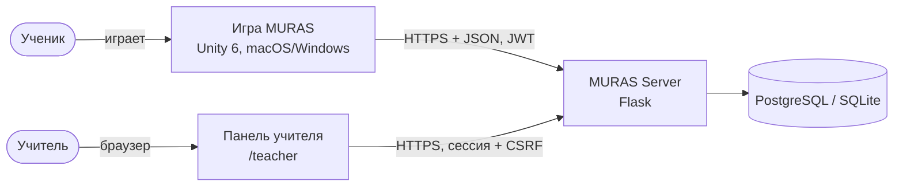
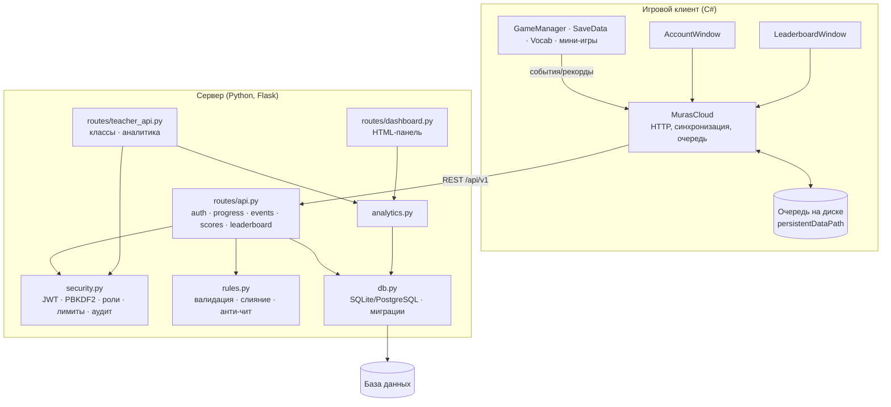
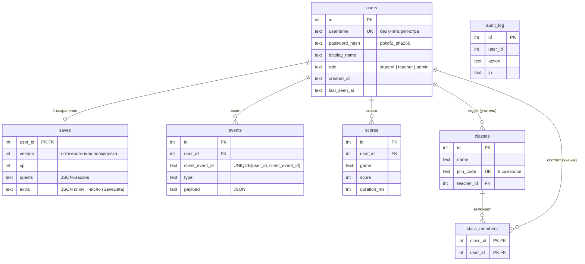
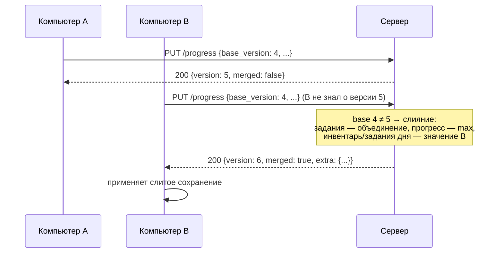

# Архитектура MURAS

## 1. Контекст

Игра полностью работает без сети. Сервер добавляет то, что невозможно на одном компьютере:
прогресс на любом устройстве, общий для класса рейтинг и обзор успехов класса для учителя.

## 2. Контейнеры и компоненты

## 3. Модель данных

Индексы: `events(user_id, type)`, `events(created_at)`, `scores(game, score)`, `scores(user_id, game)`,
`classes(teacher_id)`, `class_members(user_id)`. Каскадное удаление: удаление пользователя удаляет его
сохранение, события, рекорды и членство в классах.

## 4. Ключевые сценарии

### 4.1 Синхронизация сохранения (два устройства)

Правило слияния (`rules.merge_saves`) выбрано так, чтобы **ничего заработанного не терялось**:
слова, достижения, стадии квестов, счётчики побед и рекорды только растут, поэтому для них берётся
максимум; инвентарь тратится, а задания дня сбрасываются — для них побеждает последняя запись.

### 4.2 Офлайн-очередь событий

События (`word_unlocked`, `quest_completed`, `achievement`, `minigame_result`, `session_*`) и рекорды
сначала пишутся в файл на диске, затем отправляются пачками до 50 штук. Без сети клиент повторяет
попытку с экспоненциальной задержкой (15 → 120 с). У каждого события есть GUID, а в таблице —
`UNIQUE(user_id, client_event_id)`, поэтому повтор после потерянного ответа не создаёт дублей.

### 4.3 Аналитика учителя

`analytics.class_analytics` строит по сохранениям учеников: средние XP/слова/задания, процент учеников,
знающих каждое слово, **10 самых трудных слов** (их меньше всего открыли — материал для повторения на
уроке), процент выполнения основных заданий и активность по дням за 14 дней (из таблицы событий).

## 5. Обоснование технологий

| Решение | Альтернативы | Почему так |
|---|---|---|
| Flask | Django, FastAPI, Node/Express | Небольшой и прозрачный: каждая часть (роутинг, сессии, шаблоны) видна и объяснима; Jinja2 для панели учителя «из коробки». Django избыточен (ORM, админка), FastAPI требует async-стека без выигрыша при такой нагрузке. |
| PostgreSQL (прод) + SQLite (локально) | MongoDB, Firebase | Данные реляционные (ученик ↔ класс ↔ учитель), нужны транзакции и уникальные ограничения (идемпотентность событий). SQLite позволяет запустить сервер одной командой без установки СУБД. |
| Свой тонкий слой SQL + SQL-миграции | SQLAlchemy + Alembic | Запросы и схема видны целиком; миграции — обычные версионированные SQL-файлы. |
| JWT для игры, сессия для панели | Сессии везде, OAuth | Клиенту Unity удобен stateless-токен в заголовке; браузеру — HttpOnly-cookie с CSRF-токеном. |
| REST + JSON, OpenAPI | GraphQL, gRPC | Unity `UnityWebRequest` работает с HTTP/JSON без дополнительных библиотек. |
| Слияние сохранений на сервере | «Последняя запись побеждает», 409 + ручной выбор | Ученик может играть дома и в школе; конфликт не должен стирать прогресс и не должен требовать от ребёнка решения. |

## 6. Безопасность

| Угроза | Мера |
|---|---|
| Подбор пароля | лимит 10 попыток/мин с IP на вход и регистрацию; одинаковый ответ и время для «нет пользователя» и «неверный пароль» |
| Утечка БД | пароли — PBKDF2-SHA256 с солью, 240k итераций; секреты только в переменных окружения |
| Подделка токена | HS256 с секретом ≥ 32 байт, срок жизни 14 дней, проверка существования пользователя |
| Повышение прав | роль задаётся только сервером; регистрация учителя — по коду приглашения; `role=admin` отклоняется валидацией |
| Доступ к чужим данным (IDOR) | все запросы учителя фильтруются по `teacher_id`; чужой класс → 404 (не раскрывает существование) |
| SQL-инъекции | только параметризованные запросы; ключи сохранения ограничены `^[a-z0-9_]{1,40}$` |
| XSS | Jinja2 с автоэкранированием; запрет `<` `>` в именах; CSP `default-src 'self'` в панели |
| CSRF | токен в каждой форме панели, `SameSite=Lax`, HttpOnly-cookie |
| Clickjacking / MIME | `X-Frame-Options: DENY`, `X-Content-Type-Options: nosniff` |
| CSV-инъекции | ячейки, начинающиеся с `= + - @`, экранируются при экспорте |
| Читерство в рекордах | диапазоны правдоподобных значений для каждой игры; отклонённые попытки пишутся в `audit_log` |
| Переполнение / DoS | лимит тела запроса 256 КБ, до 100 событий в пачке, до 2000 ключей в сохранении, лимиты частоты |
| Подмена IP за прокси | `X-Forwarded-For` учитывается только при `TRUST_PROXY=1` |

## 7. Приватность

Хранится только: логин, отображаемое имя, хэш пароля, игровой прогресс, игровые события и рекорды.
Никаких e-mail, телефонов, геолокации. Учитель видит только учеников, которые сами вошли в его класс
по коду. Игрок может выгрузить все свои данные (`GET /me/export`) и удалить аккаунт со всеми данными
(`DELETE /me`). Без аккаунта игра ничего не отправляет.

## 8. Известные ограничения

* Лимитер запросов хранит счётчики в памяти — корректен для одного экземпляра сервера; для нескольких
  нужен общий Redis.
* Анти-чит проверяет правдоподобие значения, но не может доказать, что результат получен честно
  (клиент находится у игрока).
* Аналитика считается при каждом открытии страницы; для сотен учеников в классе стоит кэшировать.
